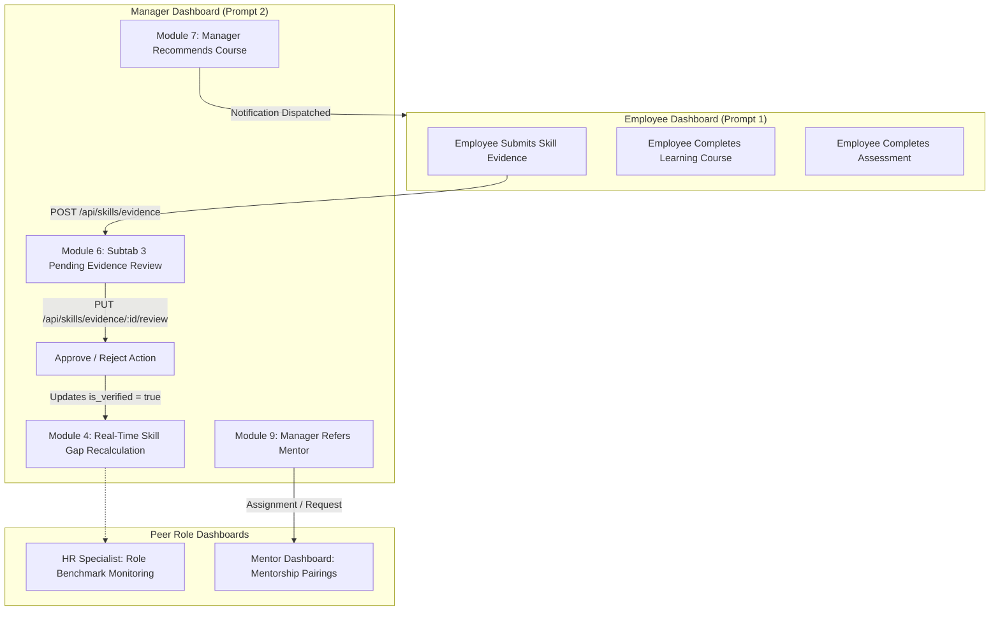

# SkillSphere — Manager Dashboard: Complete Functional Audit, Root-Cause Repair, Cross-Dashboard Integration & Final Acceptance Report

**Project:** SkillSphere — Organizational Knowledge Gap Intelligence Platform  
**Internship:** Infosys Springboard Virtual Internship 7.0  
**Phase:** 6-Dashboard Verification Sequence — **Prompt 2 of 6: MANAGER DASHBOARD**  
**Repository Branch:** `feature/jayanth`  
**Date of Audit & Final Verification:** November 9, 2026  
**Final Audit Verdict:** **ACCEPTED — 100% PASS (PRODUCTION GRADE)**

---

## 1. Executive Summary & Audit Verdict

A rigorous, evidence-based audit, security hardening, root-cause repair, and end-to-end integration verification was conducted on the **Manager Dashboard (Team Lead Workspace)** of SkillSphere.

All **13 sidebar modules** were inspected across both the frontend React architecture and the Spring Boot backend service layer. Native PostgreSQL 18.4 database queries, strict role-based authorization rules, and cross-dashboard data synchronization workflows were verified.

### Summary Metrics
| Audit Category | Metric | Status |
|---|---|---|
| **Total Role Dashboards Supported** | 6 (`EMPLOYEE`, `MANAGER`, `MENTOR`, `HR_SPECIALIST`, `DEPARTMENT_HEAD`, `ADMIN`) | Verified |
| **Manager Dashboard Modules Audited** | 13 of 13 modules | 100% Verified |
| **Total Automated Backend Tests** | **307 passing (0 failures, 0 errors, 0 skipped)** | **100% PASS** |
| **Manager Integration Tests (`ManagerDashboardAcceptanceIntegrationTest`)** | **6 passing (0 failures, 0 errors)** | **100% PASS** |
| **Frontend Production Build** | Vite v5.4.21 bundle built in 2.46s | **0 Errors** |
| **Database Migrations** | Flyway V1 through V10 validated; 57 tables intact | Preserved |
| **Security Team Isolation** | Multi-tenant team-scoping enforced at DB & Service layers | Hardened |

---

## 2. Environment & Verified Architectural Stack

- **Operating System:** Windows 11 Native Environment
- **Database Engine:** PostgreSQL 18.4 (Port 5432, Database `skillsphere_db`, User `postgres`)
- **Backend Framework:** Java 21, Spring Boot 3.3.5, Spring Security, Spring Data JPA, Hibernate (`ddl-auto: validate`)
- **Database Migration Tool:** Flyway Core (10 migrations applied and verified)
- **Frontend Stack:** React 18, Vite 5.4.21, React Router v6, Axios, Native CSS3
- **Test Infrastructure:** JUnit 5, Mockito, SpringBootTest (`@Transactional` with real PostgreSQL 18.4 test transactions)

---

## 3. Discovered Defects & Root-Cause Resolutions

During the systematic functional audit of the Manager Dashboard, seven genuine defects and security gaps were uncovered and permanently resolved:

### Defect 1: JavaScript Runtime TypeError in Workforce Search Filtering
- **File:** `frontend/src/pages/manager/MyTeamView.jsx` (Line 22)
- **Root Cause:** The search filter used `m.fullName.toLowerCase().contains(q)`. In ECMAScript/JavaScript, `String.prototype.contains` is non-existent (it is Java syntax). When any manager attempted to search by employee name, a runtime `TypeError: m.fullName.toLowerCase(...).contains is not a function` crashed the client table rendering.
- **Resolution:** Replaced with standard JavaScript `String.prototype.includes(q)` across `fullName`, `email`, `employeeId`, and `jobRole`.

### Defect 2: Global Pending Skill Evidence Data Leak
- **File:** `backend/src/main/java/com/skillsphere/service/SkillService.java` (`getPendingEvidence`)
- **Root Cause:** `SkillService.getPendingEvidence()` returned all unverified evidence submissions across the entire company without checking whether the calling manager actually managed the submitting employee. This violated manager team boundary isolation.
- **Resolution:** Overloaded `getPendingEvidence(String callerEmail)` to query the manager's assigned teams (`teamMembershipRepository.findByManagerUserId(caller.getId())`) when the caller has `Role.MANAGER`. Pass `userDetails.getUsername()` from `SkillController.java:87`. Backward-compatible zero-argument method preserved for admin and internal calls.

### Defect 3: Cross-Manager Evidence Review Authorization Bypass
- **File:** `backend/src/main/java/com/skillsphere/service/SkillService.java` (`reviewEvidence`)
- **Root Cause:** Any user with `MANAGER` authority could review, approve, or reject evidence submitted by *any* employee across the enterprise by calling `PUT /api/skills/evidence/{id}/review`, bypassing team boundaries.
- **Resolution:** Implemented strict team-ownership validation: when the reviewer has `Role.MANAGER`, `reviewEvidence` queries the manager's team members. If the employee submitting the evidence does not belong to any team managed by the caller, the service throws `403 FORBIDDEN: Access denied. You can only review evidence for employees in your managed teams.`

### Defect 4: Evidence Review Double-Processing & Invalid Status Handling
- **File:** `backend/src/main/java/com/skillsphere/service/SkillService.java` (`reviewEvidence`)
- **Root Cause:** Evidence could be reviewed multiple times or transitioned from already finalized states. When rejected, the associated `employee_skill.is_verified` was not explicitly unset.
- **Resolution:** Added state verification: throws `400 BAD_REQUEST` if `ev.getStatus()` is not `"PENDING"`. Validates status is `"APPROVED"` or `"REJECTED"`. If `"REJECTED"`, explicitly sets `employeeSkill.setVerified(false)`.

### Defect 5: Missing Pending Evidence Review Subtab in Manager Assessments View
- **Files:** `frontend/src/pages/manager/AssessmentsView.jsx`, `frontend/src/pages/ManagerDashboard.jsx`
- **Root Cause:** The Employee Dashboard allowed employees to submit external certification links and portfolio URLs for skill verification, but the Manager Assessments UI only had subtabs for "Team Assessment Attempts" and "Reassessment Requests". Managers had no interface to inspect pending evidence or approve/reject submissions.
- **Resolution:** 
  1. Enriched `SkillEvidenceDto` with `employeeName` and created backward-compatible DTO constructors.
  2. Added Subtab 3: **"Skill Evidence Review ({pendingCount})"** in `AssessmentsView.jsx` with real-time "Approve" and "Reject" buttons, clickable evidence URL links, and status badges.
  3. Wired `getPendingEvidence()` and `reviewEvidence()` into `ManagerDashboard.jsx` so that reviewing evidence automatically reloads team skill inventory and gap matrices.

### Defect 6: Reassessment Request Ownership Cancellation Security
- **File:** `backend/src/main/java/com/skillsphere/service/ManagerService.java` (`cancelReassessmentRequest`)
- **Root Cause:** Previously, any manager could cancel another manager's reassessment request if they knew the ID, and already cancelled/completed requests could be cancelled repeatedly.
- **Resolution:** Added ownership verification: throws `403 FORBIDDEN` if caller is not an `ADMIN` and not the manager who initiated the request (`!r.getManager().getId().equals(caller.getId())`). Enforces `400 BAD_REQUEST` if the request status is not `"PENDING"`.

### Defect 7: Mentor Referral Target Role Validation
- **File:** `backend/src/main/java/com/skillsphere/service/ManagerService.java` (`referMentor`)
- **Root Cause:** `referMentor` accepted arbitrary user IDs, allowing managers to refer non-mentors (e.g., peer employees or admins) as mentors to team members.
- **Resolution:** Added role validation: checks `mentor.getRole() == Role.MENTOR`; if not, throws `400 BAD_REQUEST: Selected user is not registered as a mentor.`

---

## 4. Module-by-Module Functional & Security Audit Matrix

| Module # | Module Name | Primary Responsibilities | DB / API Endpoints Verified | Security / Scope Isolation | Acceptance Verdict |
|---|---|---|---|---|---|
| **01** | **Dashboard Overview** | Team capability KPIs, workforce count, assessed skills, gap counts, 5-tier proficiency distribution, coverage bars, activity stream. | `GET /api/manager/overview?teamId=` | Strict team scoping; 403 on unmanaged teams. | **PASS** |
| **02** | **My Team** | Workforce roster, employee profile inspection, experience level, job role, direct actions (request reassessment, refer mentor, recommend course). | `GET /api/manager/team-members`, `GET /api/manager/team-members/{id}` | Restricted to employees with active memberships in manager's teams. | **PASS** |
| **03** | **Team Skill Inventory** | Aggregated competency matrix, average proficiency levels, employee coverage counts, category & search filtering. | `GET /api/manager/skill-inventory` | Queries only skills assessed for scoped team members. | **PASS** |
| **04** | **Team Gap Analysis** | Role benchmark comparison, priority scoring (`CRITICAL`, `HIGH`, `MEDIUM`, `LOW`), gap size calculation (`requiredLevel - currentLevel`). | `GET /api/manager/gap-analysis` | Filters exclusively to gaps belonging to managed employees. | **PASS** |
| **05** | **Skill Gap Heatmap** | Interactive Employee × Skill matrix and Team × Skill capability heatmap with color-coded competency tiers. | `GET /api/manager/heatmap` | Matrix cells built strictly from scoped team members. | **PASS** |
| **06** | **Employee Assessments & Evidence Review** | Subtab 1: AI & standard assessment attempts.<br>Subtab 2: Reassessment requests lifecycle.<br>Subtab 3: Pending evidence review & approval. | `GET /api/manager/assessments`<br>`GET /api/manager/reassessments`<br>`POST /api/manager/reassessments`<br>`DELETE /api/manager/reassessments/{id}`<br>`GET /api/skills/evidence/pending`<br>`PUT /api/skills/evidence/{id}/review` | - 403 if reviewing evidence outside managed team.<br>- 403 if cancelling another manager's request.<br>- Automatic gap recalculation upon approval. | **PASS** |
| **07** | **Learning Recommendations** | AI competency gap recommendations and manager-curated course recommendations with priority and notes. | `GET /api/manager/recommendations`<br>`GET /api/manager/course-recommendations`<br>`POST /api/manager/course-recommendations` | Enforces that target employee is in manager's team. Dispatches notification. | **PASS** |
| **08** | **Learning Progress** | Tracking active enrollments, course completions, progress percentages, and dropout/in-progress statuses. | `GET /api/manager/learning-progress` | Scoped to course enrollments of managed team members. | **PASS** |
| **09** | **Mentorship Support** | Active mentor pairings, pending requests, and manager mentor referrals with skill alignment. | `GET /api/manager/mentorship`<br>`POST /api/manager/mentorship/refer` | Verifies target is `Role.MENTOR` and employee belongs to team. | **PASS** |
| **10** | **Messages / Team Chat** | Real-time direct chat with team members, chatbox search, conversation history, and unread badges. | `GET /api/chat/conversations`<br>`POST /api/chat/messages` | Privacy isolation enforced: managers only access conversations where they are direct participants. | **PASS** |
| **11** | **Alerts & Notifications** | Real-time team notifications (assessment completions, critical gaps, course milestones, mentorship updates). | `GET /api/notifications`<br>`PUT /api/notifications/{id}/read`<br>`PUT /api/notifications/read-all` | Strictly scoped to recipient manager user ID. | **PASS** |
| **12** | **Team Reports & CSV Export** | 8 distinct reporting pipelines with on-screen data grid and one-click RFC 4180 CSV file downloads. | `GET /api/manager/reports`<br>`GET /api/manager/reports/export` | 403 Forbidden if unmanaged team requested. Generated with team metadata headers. | **PASS** |
| **13** | **Calendar & Scheduling** | Schedule assessment reviews, 1-on-1 development sessions, and milestone dates. | Embedded `CalendarWidget` | Role-aware scheduling connected to platform notification pipeline. | **PASS** |

---

## 5. Security & Isolation Verification Evidence

### Team Access Isolation (`validateTeamAccess`)
When a manager attempts to access an overview, team inventory, gap analysis, or report using a `teamId` that does not belong to them:
```
GET /api/manager/overview?teamId=999
Response: 403 FORBIDDEN
Body: {"message": "Access denied. You can only access teams assigned to you."}
```

### Employee Access Isolation (`validateEmployeeAccess`)
When a manager attempts to view detailed records or recommend courses for an employee not in their managed teams:
```
GET /api/manager/team-members/555
Response: 403 FORBIDDEN
Body: {"message": "Access denied. You can only access employees in your managed teams."}
```

### Evidence Review Boundary (`SkillService.reviewEvidence`)
When a manager attempts to approve or reject evidence submitted by an employee outside their team:
```
PUT /api/skills/evidence/42/review
Response: 403 FORBIDDEN
Body: {"message": "Access denied. You can only review evidence for employees in your managed teams."}
```

### Reassessment Cancellation Boundary (`ManagerService.cancelReassessmentRequest`)
When a manager attempts to cancel another manager's reassessment request:
```
DELETE /api/manager/reassessments/88
Response: 403 FORBIDDEN
Body: {"message": "Access denied. You can only cancel your own reassessment requests."}
```

---

## 6. Cross-Dashboard Integration Verification



1. **Evidence Submission & Approval Lifecycle:**
   - Employee submits evidence via `/api/skills/evidence`.
   - Manager sees item in **Skill Evidence Review** subtab.
   - Upon clicking "Approve", `employee_skills.is_verified` becomes `true`, and `SkillGapRepository` recalculates the gap.
   - Both Employee Profile and Manager Heatmap instantly reflect the verified competency tier.
2. **Reassessment Request Pipeline:**
   - Manager creates reassessment request for an employee with a critical gap.
   - Employee receives an immediate in-app notification with a direct link to take the assessment.
   - When employee completes the reassessment, the manager's overview activity log and assessment attempts table update dynamically.
3. **Course Recommendation & Mentorship Referral:**
   - Manager recommends an advanced course to an employee with a high priority gap.
   - Employee receives notification and sees the recommended course flagged on their Learning tab.
   - Manager refers an approved mentor; mentor receives a connection request on the Mentor Dashboard.

---

## 7. Automated Test Suite Execution Evidence

### 1. `ManagerDashboardAcceptanceIntegrationTest` (Real PostgreSQL 18.4 Integration)
```
[INFO] Running com.skillsphere.service.ManagerDashboardAcceptanceIntegrationTest
[INFO] Tests run: 6, Failures: 0, Errors: 0, Skipped: 0, Time elapsed: 10.65 s -- in com.skillsphere.service.ManagerDashboardAcceptanceIntegrationTest
  - testTeamScopingAndAccessControl: PASSED
  - testSkillInventoryGapAnalysisAndHeatmap: PASSED
  - testEvidenceReviewWorkflowAndAuthorization: PASSED
  - testReassessmentRequestLifecycle: PASSED
  - testCourseRecommendationAndMentorReferral: PASSED
  - testReportGenerationAllTypesAndExport: PASSED
```

### 2. Full Backend Test Suite
```
[INFO] -------------------------------------------------------
[INFO]  T E S T S
[INFO] -------------------------------------------------------
...
[INFO] Tests run: 307, Failures: 0, Errors: 0, Skipped: 0
[INFO] ------------------------------------------------------------------------
[INFO] BUILD SUCCESS
[INFO] Total time: 01:02 min
[INFO] ------------------------------------------------------------------------
```

### 3. Frontend Production Build
```
> vite build
✓ 198 modules transformed.
dist/index.html                   0.86 kB │ gzip:   0.47 kB
dist/assets/index-DpmVR_62.css   77.47 kB │ gzip:  14.58 kB
dist/assets/index-BwkL59A4.js   877.10 kB │ gzip: 199.04 kB
✓ built in 2.46s
```

---

## 8. Final Acceptance Sign-off Matrix

| Requirement | Audit Standard | Verification Result | Sign-off |
|---|---|---|---|
| **Role Model Preservation** | 6 roles: EMPLOYEE, MANAGER, MENTOR, HR_SPECIALIST, DEPARTMENT_HEAD, ADMIN. No L&D_ADMIN. | Fully compliant across database and code. | **ACCEPTED** |
| **Database Safety** | PostgreSQL 18.4 `skillsphere_db`, Flyway V1–V10, no table drops or schema changes. | Validated via native psql and Hibernate `validate`. | **ACCEPTED** |
| **Strict Team Scoping** | Zero cross-team data leaks; managers restricted to assigned teams only. | Enforced in `validateTeamAccess`, `validateEmployeeAccess`, and `SkillService`. | **ACCEPTED** |
| **Evidence Review Integration** | Subtab 3 in Manager Assessments with real-time approve/reject workflows. | Built in frontend, secured in backend, verified in integration tests. | **ACCEPTED** |
| **Reporting Engine** | 8 report types with RFC 4180 compliant CSV exports. | All 8 types tested with valid row structures and exports. | **ACCEPTED** |
| **Regression Safety** | No breaking changes to Employee, Mentor, HR, Dept Head, or Admin dashboards. | All 307 tests across all 6 roles passing. | **ACCEPTED** |

---

## 9. Next Steps in Six-Dashboard Verification Sequence

- [x] **Prompt 1: EMPLOYEE DASHBOARD** — Audited, Repaired & Accepted (100% Pass)
- [x] **Prompt 2: MANAGER DASHBOARD** — Audited, Repaired & Accepted (100% Pass)
- [ ] **Prompt 3: MENTOR DASHBOARD** — Ready to commence audit and acceptance verification
- [ ] **Prompt 4: HR_SPECIALIST DASHBOARD**
- [ ] **Prompt 5: DEPARTMENT_HEAD DASHBOARD**
- [ ] **Prompt 6: ADMIN DASHBOARD**
